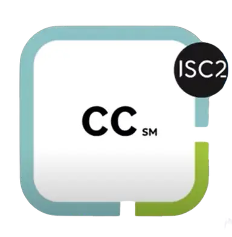
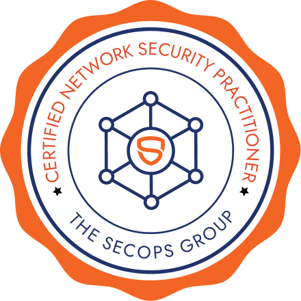

<div align="center">


<br>


</div>

---

## `>_` Profile

```console
xor1@redteam:~$ whoami
Muhammad Faisal Farooq (XOR1)

xor1@redteam:~$ cat profile.txt
role     : Cybersecurity Student · Offensive Security Researcher
focus    : Adversary emulation · Penetration testing · Ethical offensive operations
surface  : Web applications · Active Directory · Network infrastructure
practice : CTFs · TryHackMe learning paths · Documented lab work
ethos    : Break the system. Understand the system. Secure the system.
```

- **Research:** Adversary emulation and the tradecraft behind modern intrusion chains across web, Active Directory and network infrastructure.
- **Practice:** CTFs, TryHackMe learning paths and hands-on labs, written up as reproducible methodology.
- **Engineering:** x86 assembly, Python and C++ to build tooling and reason about systems below the application layer.
- **Standards:** Authorized, scoped and ethical testing only, grounded in ISO/IEC 27001 and ISC2 security fundamentals.

---

## `>_` Core Domains

| Domain | Focus |
| :-- | :-- |
| **Adversary Emulation** | Modelling attacker tradecraft end to end in controlled, authorized exercises |
| **Web Exploitation** | Injection, broken authentication and access control, content discovery, request tampering |
| **Active Directory** | Enumeration, attack-path analysis, credential and privilege abuse in lab environments |
| **Infrastructure Pentesting** | Network discovery, service enumeration, exploitation and post-exploitation |
| **Low-Level Systems** | x86 assembly and computer organization: how code executes at the machine level |
| **Security Governance** | ISO/IEC 27001 and compliance, including Python tooling for Windows compliance checks |

---

## `>_` Toolkit

| Category | Stack |
| :-- | :-- |
| **Recon & Enumeration** |     |
| **Exploitation** |    |
| **Traffic Analysis** |  |
| **Languages** |     |
| **Environment** |    |

---

## `>_` Selected Work

| Repository | Description |
| :-- | :-- |
| [**Practical-Pentesting-Writeups**](https://github.com/xor-1/Practical-Pentesting-Writeups) | Hands-on penetration testing, red team labs, CTF challenges and offensive security research |
| [**CyberSecurity_TryHackMe**](https://github.com/xor-1/CyberSecurity_TryHackMe) | Notes from TryHackMe learning paths |
| [**Sentinel-EDR-x86-ASM-**](https://github.com/xor-1/Sentinel-EDR-x86-ASM-) | x86 assembly project for the Computer Organization and Assembly Language course |
| [**Learn-x86-ASM-with-XOR1**](https://github.com/xor-1/Learn-x86-ASM-with-XOR1) | x86 assembly learning repository |
| [**Windows-Compliance-Tool-v-1.0**](https://github.com/xor-1/Windows-Compliance-Tool-v-1.0) | Python Windows compliance tool |
| [**vibe-term**](https://github.com/xor-1/vibe-term) | Customized Ubuntu terminal on Zsh + Powerlevel10k |
| [**DSA-Practice-Hub**](https://github.com/xor-1/DSA-Practice-Hub) | C++ data structures and algorithms practice: lists, trees, graphs, searching and sorting |

---

## `>_` Certifications

<div align="center">

<table>
  <tr>
    <td align="center" valign="middle"></td>
    <td align="center" valign="middle"></td>
    <td align="center" valign="middle"></td>
    <td align="center" valign="middle"></td>
  </tr>
  <tr>
    <td align="center"><sub><b>ISC2 CC</b><br>Certified in Cybersecurity</sub></td>
    <td align="center"><sub><b>ISO/IEC 27001</b><br>Information Security Associate</sub></td>
    <td align="center"><sub><b>Google</b><br>Cybersecurity Certificate</sub></td>
    <td align="center"><sub><b>CNSP</b><br>Certified Network Security Practitioner</sub></td>
  </tr>
</table>

</div>

---

## `>_` Telemetry

<div align="center">


<br>


</div>

---

## `>_` TryHackMe

<div align="center">

<a href="https://tryhackme.com/p/muhammadfaysalfarooq">
  
</a>

</div>

---

## `>_` Contact

<div align="center">

<a href="https://linkedin.com/in/muhammadfaisalfarooq/"></a>
<a href="mailto:faisalfarooq17121@gmail.com"></a>

</div>

---

> [!NOTE]
> All tools, scripts and techniques shared here are for educational purposes and authorized security testing only.

<div align="center">


</div>
